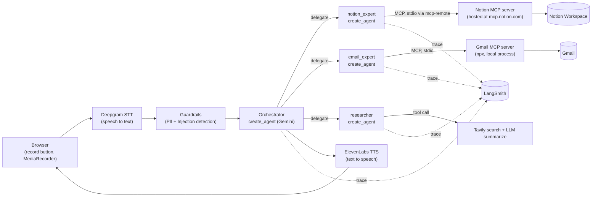
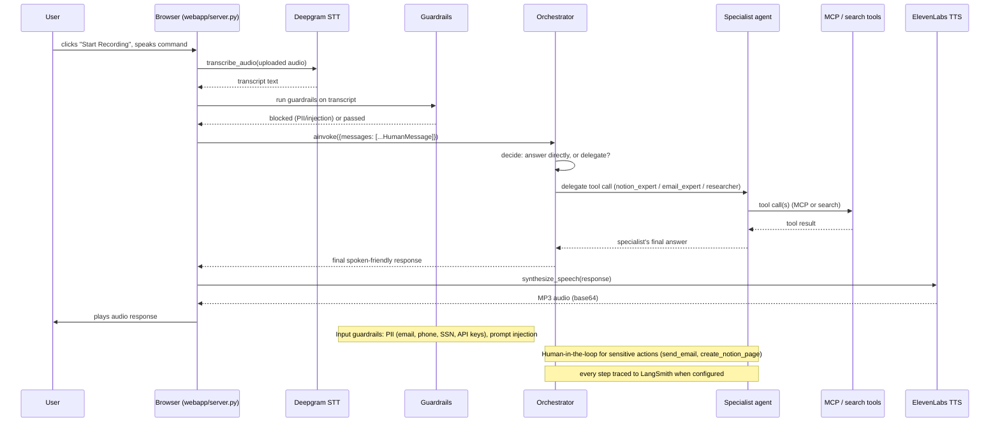

# LangChain Voice Agent for Gmail + Notion

A voice-controlled executive assistant built with **LangChain's `create_agent`** and **Google Gemini** that takes spoken commands and acts on your real Gmail inbox and Notion workspace — checking email, drafting and sending replies, researching topics on the web, and writing results into Notion pages.

It's a **multi-agent system**: a generalist Orchestrator answers plain questions itself and delegates anything Gmail-, Notion-, or research-shaped to a specialist sub-agent that owns just that one job.

```
Orchestrator -> notion_expert  (Notion MCP tools)
             -> email_expert   (Gmail MCP tools)
             -> researcher     (web search + summarize)
```

Gmail and Notion aren't wired up as hand-rolled API clients — each specialist reaches its service over the **Model Context Protocol (MCP)**: a local Gmail MCP server (`@gongrzhe/server-gmail-autoauth-mcp`) and Notion's official hosted MCP server (`mcp.notion.com`, via the `mcp-remote` stdio bridge). Each authenticates itself once via a cached OAuth token.

Every agent/tool call is traced to **LangSmith** when configured, so you can see exactly which specialist handled a request and what it did.

This repo is the companion code for a type-along video tutorial. See [tutorial.md](tutorial.md) for the step-by-step teaching script.

---

## What it does

- **"What's the latest unread message in my inbox?"**
  → reads your Gmail inbox via the Gmail MCP tools.

- **"Draft a reply to that saying I'll follow up Monday."**
  → drafts a reply and reads it back to you before sending (the agent is instructed to always confirm before actually sending).

- **"Research the pros and cons of server-side rendering and save it to Notion."**
  → searches the web, summarizes the findings, and creates a new Notion page.

- **"Search my Notion workspace for anything about pricing."**
  → uses the Notion MCP tools to search and read back matches.

---

## Architecture



### Key Components

| Component | Technology | Purpose |
|-----------|------------|---------|
| **STT** | Deepgram (primary) / OpenAI Whisper (fallback) | Speech-to-text |
| **TTS** | ElevenLabs (primary) / OpenAI TTS (fallback) | Text-to-speech |
| **LLM** | Google Gemini (primary) / OpenAI (fallback) | Agent reasoning |
| **Guardrails** | Custom middleware | PII detection, prompt injection blocking, human-in-the-loop |
| **MCP** | Gmail + Notion via stdio | Secure tool access |
| **Search** | Tavily + LLM summarization | Web research |

---

## Request Lifecycle (One Voice Turn)



---

## Project Layout

```
voice_notion_agent/
├── config.py              # env var loading + validation + provider switching
├── mcp_client.py          # MultiServerMCPClient config for Gmail + Notion
├── speech_to_text.py      # Deepgram (primary) / Whisper (fallback) STT
├── text_to_speech.py      # ElevenLabs (primary) / OpenAI TTS (fallback)
├── guardrails.py          # Input/output guardrails + human-in-the-loop
├── agent.py               # Orchestrator: builds specialists, delegates via tools
├── agents/
│   ├── notion_expert.py    # specialist: Notion MCP tools only
│   ├── email_expert.py     # specialist: Gmail MCP tools only
│   └── researcher.py       # specialist: web search + summarize
└── tools/
    └── research_tool.py   # web search (Tavily) + LLM summarization

webapp/
├── server.py              # FastAPI app: browser mic -> STT -> agent -> TTS
└── static/index.html      # single-page UI (click-to-toggle recording + text fallback)

Dockerfile                 # Python + Node.js (MCP servers run via global binaries)
render.yaml                # Render Docker-based web service config
scripts/pack_mcp_tokens.py # packs local MCP tokens for Render deployment
```

---

## ✨ New Features (v2.0)

### 1. **Click-to-Toggle Recording**
- Click **"🎤 Start Recording"** to begin
- Click **"🛑 Stop Recording"** to end
- Works on desktop (click) and mobile (tap)
- Live audio level meter shows mic activity

### 2. **Guardrails (Security)**
- **PII Detection**: Blocks emails, phones, SSN, credit cards, API keys
- **Prompt Injection Detection**: Blocks "ignore previous instructions", "system prompt", etc.
- **Human-in-the-Loop**: Sensitive actions (send_email, create_notion_page) require approval
- Configurable via `ENABLE_GUARDRAILS`, `ENABLE_HUMAN_IN_LOOP`

### 3. **Multi-Provider Support**
| Service | Primary | Fallback |
|---------|---------|----------|
| **LLM** | Google Gemini | OpenAI |
| **STT** | Deepgram | OpenAI Whisper |
| **TTS** | ElevenLabs | OpenAI TTS |

### 4. **Better Error Handling**
- Specific error messages for each provider
- Rate limit handling with user-friendly messages
- TTS errors shown in UI while text reply still works

---

## Setup

### 0. Prerequisites
- **Python 3.11 or 3.12** (LangChain has known typing issues on 3.14+)
- **Node.js 18+** (Gmail and Notion MCP servers launched via global binaries)

### 1. Create Virtual Environment & Install
```bash
python3.12 -m venv .venv
source .venv/bin/activate
pip install -r requirements.txt
```

### 2. Configure Environment
```bash
cp .env.example .env
# Edit .env with your keys:
```
**Required:**
- `TAVILY_API_KEY` — from https://app.tavily.com (web search)

**LLM Provider (choose one):**
- `GOOGLE_API_KEY` — from https://aistudio.google.com (Gemini)
- `OPENAI_API_KEY` — from https://platform.openai.com (OpenAI fallback)

**STT Provider (choose one):**
- `DEEPGRAM_API_KEY` — from https://console.deepgram.com (primary)
- `OPENAI_API_KEY` — for Whisper fallback

**TTS Provider (choose one):**
- `ELEVENLABS_API_KEY` — from https://elevenlabs.io (primary)
- `OPENAI_API_KEY` — for TTS fallback

**Optional:**
- `LANGSMITH_API_KEY` — for tracing
- `AUTH_PASSWORD` — **REQUIRED** before public deployment

### 3. One-Time Gmail Auth
```bash
# 1. Create Google Cloud OAuth client (Web app, redirect: http://localhost:3000/oauth2callback)
# 2. Save as ~/.gmail-mcp/gcp-oauth.keys.json
# 3. Run once:
npx @gongrzhe/server-gmail-autoauth-mcp auth
# 4. Install globally (avoids npx registry check on every call):
npm install -g @gongrzhe/server-gmail-autoauth-mcp
```

### 4. One-Time Notion Auth
```bash
# 1. Run once:
npx -y mcp-remote https://mcp.notion.com/mcp
# 2. Install globally:
npm install -g mcp-remote
```

### 5. Run Locally
```bash
uvicorn webapp.server:app --reload --port 8000
```
Open http://localhost:8000 — click "🎤 Start Recording", speak, click "🛑 Stop Recording".

---

## Environment Variables

```env
# LLM Provider (gemini | openai)
LLM_PROVIDER=gemini
CHAT_MODEL=gemini-3.5-flash          # or gemini-3.8-flash, gpt-4o-mini
GOOGLE_API_KEY=...
OPENAI_API_KEY=...

# STT Provider (deepgram | openai)
STT_PROVIDER=deepgram
STT_MODEL=nova-2
DEEPGRAM_API_KEY=...

# TTS Provider (elevenlabs | openai)
TTS_PROVIDER=elevenlabs
TTS_MODEL=eleven_flash_v2_5
TTS_VOICE=JBFqnCBsd6RMkjVDRZzb       # free-tier compatible voice
ELEVENLABS_API_KEY=...

# Search
TAVILY_API_KEY=...

# Guardrails
ENABLE_GUARDRAILS=true
ENABLE_HUMAN_IN_LOOP=true

# LangSmith (optional)
LANGSMITH_TRACING=true
LANGSMITH_API_KEY=lsv2_...
LANGSMITH_PROJECT=voice-agent-demo

# Auth (REQUIRED for public deploy)
AUTH_USERNAME=demo
AUTH_PASSWORD=your-secure-password
```

---

## Observability (LangSmith)

Every agent/tool call is traced automatically when configured:
- Orchestrator routing decisions
- Specialist reasoning & tool calls
- MCP tool invocations
- Guardrail triggers

Set in `.env`:
```env
LANGSMITH_TRACING=true
LANGSMITH_ENDPOINT=https://api.smith.langchain.com
LANGSMITH_API_KEY=lsv2_...
LANGSMITH_PROJECT=voice-agent-demo
```

---

## Browser Demo + Deployment

### Local Development
```bash
uvicorn webapp.server:app --reload --port 8000
```

### ⚠️ Before Public Deployment
**Set `AUTH_PASSWORD`** — without it, anyone with the link can read your Gmail or send mail. When set, all routes (including the page) require HTTP Basic Auth.

### Deploying to Render (Free Tier)
1. On machine with completed Gmail/Notion auth:
   ```bash
   python scripts/pack_mcp_tokens.py
   ```
   Outputs `GMAIL_MCP_TAR_B64` and `MCP_AUTH_TAR_B64` — **treat as passwords**.

2. Push repo to GitHub (tokens NOT committed).

3. In Render: "New Web Service" → connect repo → detects `render.yaml` + `Dockerfile`.

4. Set env vars in Render dashboard:
   - `OPENAI_API_KEY`, `TAVILY_API_KEY`, `GOOGLE_API_KEY`, `DEEPGRAM_API_KEY`, `ELEVENLABS_API_KEY`
   - `GMAIL_MCP_TAR_B64`, `MCP_AUTH_TAR_B64`
   - `AUTH_PASSWORD` (required)
   - `LANGSMITH_API_KEY` (optional)

4. Deploy. Render provides `https://<name>.onrender.com` — mic access requires HTTPS.

**Free-tier caveat:** Services spin down after ~15 min inactivity. Warm up before demos.

---

## Troubleshooting

| Issue | Solution |
|-------|----------|
| **Gemini 429/503** | Switch model: `CHAT_MODEL=gemini-3.5-flash` or `LLM_PROVIDER=openai` |
| **ElevenLabs 402** | Use free-tier voice: `TTS_VOICE=JBFqnCBsd6RMkjVDRZzb` |
| **STT empty** | Test with real speech (sine wave returns empty correctly) |
| **MCP "file not found"** | Run `npm install -g @gongrzhe/server-gmail-autoauth-mcp mcp-remote` |
| **Port in use** | `taskkill /F /PID <pid>` or use different port |

---

## License
MIT — use freely, but **protect your API keys and MCP tokens**.